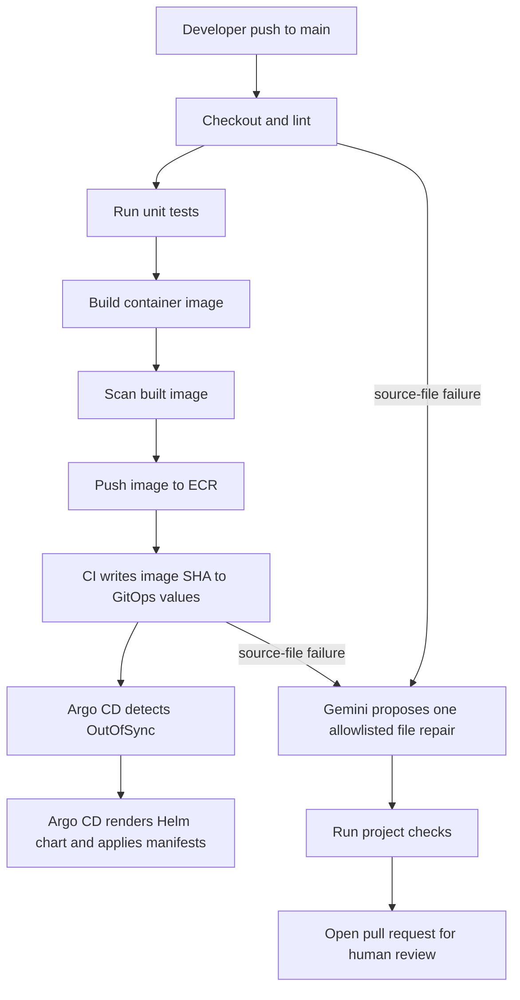

# AI-Assisted Self-Healing DevOps on EKS

An educational GitHub Actions project that validates an application, builds and scans a Docker image, pushes it to Amazon ECR, then updates the image tag in the GitOps branch. Argo CD polls that branch, renders the Helm chart using its built-in Helm engine, and applies the manifests to Amazon EKS. Gemini can propose a repair pull request for supported source-file failures; a person reviews every AI change before merge.

> The project creates AWS resources and can incur charges. Run it in a sandbox AWS account. Never commit API keys, AWS credentials, or kubeconfig files.

## What it does



Pull requests run lint, unit tests, a local image build, and an image scan, without AWS credentials or GitOps write access. On `main`, after validation and scanning succeed, CI publishes the image to ECR and updates `helm/app/values.yaml` on the `gitops` branch. Argo CD continuously watches that branch. Helm is used by Argo CD to render templates; the GitHub runner does not install or run Helm as a deployment tool, and no GitHub workflow connects to EKS.

## Repository layout

```text
Ai-project/
├── app/index.html                 Demo web application
├── Dockerfile                     Non-root Nginx container image
├── checks/check_html.py           HTML-specific checker
├── checks/check_project.py        Python, HTML, YAML, shell, and Helm checks
├── helm/app/                      Kubernetes Helm chart
├── argocd/application.yaml        Argo CD Application definition
├── .github/workflows/ci.yml       Validate, scan, publish, and update GitOps values
└── .github/workflows/autofix.yml  Gemini diagnosis and review PR
```

## Optional: preview the app locally

Requirements: Git, Python 3.10+, Docker, and (for the full local checker) `yamllint`, PyYAML, and Helm. The checker runs Hadolint from its versioned container image.

```bash
cd Ai-project
python3 -m pip install yamllint PyYAML
./check.sh
docker build -t self-healing-demo:local .
docker run --rm -p 8080:80 self-healing-demo:local
```

Open `http://localhost:8080` to see the application. Alternatively, `./run-local.sh` starts a named container in the background; stop it with `docker rm -f self-healing-demo-local`.

This is only a local preview. The EKS pipeline does not call `run-local.sh`; GitHub Actions builds and publishes the image, and Argo CD deploys it to your cluster.

The lint checker is intentionally deterministic. It checks HTML structure, Python syntax, YAML formatting/syntax, shell syntax, the Dockerfile, and Helm lint/render output. Unit tests exercise the HTML checker. The web container runs as a non-root user with a read-only root filesystem and serves on port 8080. CI builds the image before scanning it, then publishes it to ECR only after the scan passes.

## 2. Create AWS resources

Use your EKS cluster in `ap-south-1` (`suren-eks-cluster`, Kubernetes 1.36). The CI workflow checks for the `self-healing-demo` ECR repository and creates it with scan-on-push enabled if it is missing. Ensure EKS worker nodes can pull from ECR (the standard EKS node role commonly has `AmazonEC2ContainerRegistryReadOnly`). Configure GitHub Actions OIDC as the AWS identity provider; do not use long-lived access keys.

Create one IAM role and restrict its trust policy to your repository and the expected GitHub subject `repo:OWNER/REPOSITORY:ref:refs/heads/main`.

- **CI role:** ECR repository describe/create permissions, ECR login, and image push permissions for the configured repository. At minimum, grant `ecr:DescribeRepositories`, `ecr:CreateRepository`, `ecr:GetAuthorizationToken`, `ecr:BatchCheckLayerAvailability`, `ecr:InitiateLayerUpload`, `ecr:UploadLayerPart`, `ecr:CompleteLayerUpload`, and `ecr:PutImage`. Creation is only attempted when the repository is missing.

Argo CD needs read access to the GitOps repository and its in-cluster service account needs the permissions required to deploy the chart resources. GitHub Actions does not need an EKS access entry or Kubernetes credentials.

## 3. Configure the GitHub repository

To create a separate public GitHub repository from this folder, run these commands after creating an empty repository on GitHub:

```bash
cd Ai-project
git init -b main
git add .
git commit -m "Initial EKS self-healing CI/CD project"
git remote add origin https://github.com/YOUR_GITHUB_NAME/YOUR_REPOSITORY.git
git push -u origin main
```

Or, with GitHub CLI authenticated, create and push the public repository in one command:

```bash
gh repo create YOUR_REPOSITORY --public --source=. --remote=origin --push
```

You can also use this as a subdirectory in an existing repository, but adjust workflow paths and the Argo CD repository source as needed. In **Settings → Secrets and variables → Actions**, add:

| Name | Type | Value |
|---|---|---|
| `AWS_CI_ROLE_ARN` | Secret | ARN of the OIDC role allowed to push to this ECR repository |
| `GEMINI_API_KEY` | Secret | Gemini API key from Google AI Studio |
| `AWS_REGION` | Variable | `ap-south-1` |
| `AWS_ACCOUNT_ID` | Variable | 12-digit AWS account ID |
| `ECR_REPOSITORY` | Variable | `self-healing-demo` (repository name only) |

Add `GEMINI_API_KEY` as a repository secret; do not put the key in a workflow file. The current Gemini model default is `gemini-3.8-flash`; set `GEMINI_MODEL` in the autofix workflow if you want another model. Gemini is called only when a CI or Argo CD failure identifies one supported project file.

In **Settings → Actions → General**, allow GitHub Actions to create pull requests. The publish job needs repository contents write permission so it can update the `gitops` branch. Validation runs in a separate job with read-only contents permission. Protect `main`; consider protecting the GitOps branch so only the workflow and authorized maintainers can update it.

### Initialize the GitOps branch

After the first push to `main`, create the deployment-tracking branch with the same chart and Argo manifest:

```bash
git switch main
git switch -c gitops
git push -u origin gitops
git switch main
```

Argo CD watches `gitops`, not `main`. CI pushes each scanned image to ECR with both its commit SHA and the mutable `latest` alias, then pins the unique SHA tag in GitOps `values.yaml`. Argo CD notices the branch change and syncs the chart; it uses Helm's rendering engine internally. `latest` is a convenience alias, not the deployment reference.

## 4. Start the pipeline

1. Commit and push a change to `main`.
2. In **Actions → CI**, follow the stages: checkout, lint, unit tests, Docker build, image scan, ECR repository ensure/create, ECR push, then update `helm/app/values.yaml` on `gitops` with the image SHA.
3. Argo CD polls `gitops`, sees the Application is `OutOfSync`, renders `helm/app` using its built-in Helm engine, and applies the Kubernetes manifests to EKS.
4. Check the Argo CD Application health and the app LoadBalancer URL. The Service listens on port 8080.

### See the app and Argo CD UI

From a machine with `kubectl` configured for EKS, get the public app LoadBalancer hostname:

```sh
kubectl get service self-healing-demo -n self-healing-demo -w
```

When `EXTERNAL-IP` shows an AWS hostname, open `http://<EXTERNAL-IP>:8080` in a browser. Stop watching with Ctrl+C after the hostname appears.

The Argo CD server is internal by default, so it does not have a public URL. To open its UI securely, run this on a machine that can reach the EKS API:

```sh
kubectl port-forward service/argocd-server -n argocd 8080:443
```

Then open `https://localhost:8080`, sign in as `admin`, and get the initial password with:

```sh
kubectl -n argocd get secret argocd-initial-admin-secret \
  -o jsonpath='{.data.password}' | base64 --decode; echo
```

The browser may show a certificate warning for this local port-forward. It does not make Argo CD public. Avoid changing the Argo CD Service to a public LoadBalancer unless you also configure TLS and restrict access.

## 5. Demonstrate AI-assisted repair

Use a disposable feature branch. Make a small syntax or structure error in an application, checker, workflow, Argo CD, or Helm file, then push it to GitHub. The AI workflow listens for failed CI runs and Argo CD notifications, selects one allowlisted file when the failure identifies it, asks Gemini for a complete-file candidate, and runs the project checker, unit tests, and Docker build. If all pass, it opens a PR containing only that file. Infrastructure/API availability failures and errors without a clear file target do not trigger a speculative repair.

Review the diff and CI results as you would any other code. The agent cannot merge the PR or deploy it. Do not put secrets or production data into test files. To test manually, dispatch **AI Autofix PR** and optionally specify an allowlisted `target_file`.

### Connect Argo CD failures to Autofix

Argo CD needs a GitHub fine-grained personal access token limited to this repository with **Contents: read and write** permission so its Notifications controller can send a `repository_dispatch` event. Keep this token in the cluster secret, not in GitHub Actions or a manifest file. After pushing these workflow and notification files to `main`, create the secret and apply the configuration from a machine with cluster access:

```sh
read -rsp 'GitHub dispatch token: ' GITHUB_DISPATCH_TOKEN; echo
kubectl create secret generic argocd-notifications-secret -n argocd \
  --from-literal=github-token="$GITHUB_DISPATCH_TOKEN" \
  --dry-run=client -o yaml | kubectl apply -f -
unset GITHUB_DISPATCH_TOKEN
kubectl apply -f argocd/notifications.yaml
kubectl apply -f argocd/application.yaml
```

The configuration dispatches on failed syncs, unknown sync state, or degraded health. Autofix opens a PR only when the event points to a supported source file; it does not try to repair EKS/API availability or other infrastructure failures.

### EKS OpenAPI errors

`https://kubernetes.default.svc` is the normal in-cluster Kubernetes API address for Argo CD; it is not a local machine. If Argo CD reports that the API server cannot serve OpenAPI resources, check the EKS control plane and Argo controller before changing Helm resources. From a machine configured with `kubectl` for the cluster, run:

```sh
aws eks describe-cluster --name suren-eks-cluster --region ap-south-1 \
  --query 'cluster.{status:status,version:version,endpoint:endpoint}'
kubectl get --raw='/readyz?verbose'
kubectl get --raw='/openapi/v2' >/dev/null && echo OPENAPI_OK || echo OPENAPI_FAILED
kubectl get pods -n argocd -o wide
kubectl logs -n argocd statefulset/argocd-application-controller \
  --all-containers --since=30m --tail=100
```

If `/readyz` or `/openapi/v2` fails from `kubectl`, the problem is at the EKS API/control-plane layer; review EKS cluster health and API server control-plane logs in CloudWatch, and contact AWS Support if it remains unhealthy. If those checks pass but Argo still fails, use the application-controller logs to investigate its in-cluster path to the API. GitHub Actions does not install Helm in EKS or connect to the cluster for deployment.

## What it can and cannot repair

The Gemini workflow is a bounded repair proposal, not an autonomous production operator. It attempts allowlisted file-level failures reported by CI or Argo CD notifications. Infrastructure errors, missing IAM permissions, exhausted quotas, runner failures, and vulnerability findings without a safe file-level correction do not trigger a speculative repair. A workflow YAML syntax error may prevent GitHub from starting the workflow, so no `workflow_run` event exists for the repair workflow to handle it. Model output is untrusted until reviewed and merged.

## Cost and safety notes

- EKS, load balancers, ECR storage, and data transfer can incur AWS charges.
- Use a sandbox account and remove resources when finished.
- Use OIDC and least-privilege roles; avoid AWS access-key secrets.
- Keep the GitOps branch protected from ordinary developer pushes, while allowing the deployment bot to update it as configured.
- The sample exposes the app through a Kubernetes `LoadBalancer` service. Restrict access or replace it with an ingress and TLS before using a real application.

## Start and finish checklist

**Start:** create EKS and the CI OIDC role → install Argo CD in the cluster → configure GitHub secrets/variables → initialize `gitops` → push to `main`. The local Docker preview is optional.

**Finish:** review the CI scan/build results → check the Argo CD Application and deployed app → test a repair on a disposable branch → review and merge the AI PR manually → delete the AWS demo resources when done.

## References

- [Gemini API model list](https://ai.google.dev/gemini-api/docs/models)
- [Google Gen AI Python SDK](https://github.com/googleapis/python-genai)
- [Argo CD Helm chart](https://github.com/argoproj/argo-helm/tree/main/charts/argo-cd)
- [Argo CD Applications](https://argo-cd.readthedocs.io/en/stable/user-guide/application-specification/)
- [GitHub Actions OIDC in AWS](https://docs.aws.amazon.com/IAM/latest/UserGuide/id_roles_providers_create_oidc.html)
