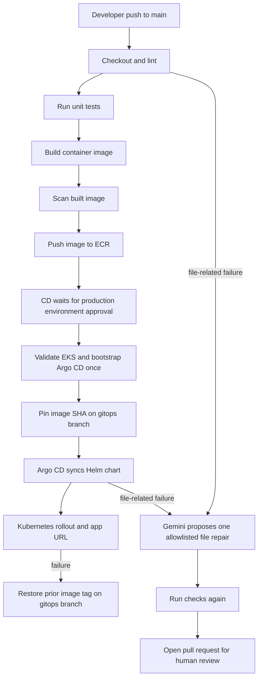

# AI-Assisted Self-Healing DevOps on EKS

An educational GitHub Actions project that validates an application, scans and builds a Docker image, pushes it to Amazon ECR, and uses Argo CD with Helm to deploy to Amazon EKS. When a CI or CD failure points to a supported project file, Gemini may propose a repair in a pull request. A person reviews every AI change before merge.

> The project creates AWS resources and can incur charges. Run it in a sandbox AWS account. Never commit API keys, AWS credentials, or kubeconfig files.

## What it does



CI jobs on pull requests run lint, unit tests, a local image build, and an image scan but do not receive AWS credentials or publish to ECR. On `main`, a successful image scan is followed by ECR publication; the CD workflow starts after the CI run succeeds. GitOps state is written to a separate `gitops` branch so Argo CD can continuously reconcile the Helm release.

## Repository layout

```text
Ai-project/
├── app/index.html                 Demo web application
├── Dockerfile                     Non-root Nginx container image
├── checks/check_html.py           HTML-specific checker
├── checks/check_project.py        Python, HTML, YAML, shell, and Helm checks
├── helm/app/                      Kubernetes Helm chart
├── argocd/application.yaml        Argo CD Application definition
├── .github/workflows/ci.yml       Lint, unit test, build, scan, and push image
├── .github/workflows/cd.yml       Approval, EKS, GitOps update, rollout/rollback
└── .github/workflows/autofix.yml  Gemini diagnosis and review PR
```

## Optional: preview the app locally

Requirements: Git, Python 3.10+, Docker, and (for the full local checker) `yamllint`, PyYAML, and Helm. The checker runs Hadolint from its versioned container image.

```bash
cd Ai-project
python3 -m pip install yamllint PyYAML
./check.sh
docker build -t self-healing-demo:local .
docker run --rm -p 8080:80 self-healing-demo:local
```

Open `http://localhost:8080` to see the application. Alternatively, `./run-local.sh` starts a named container in the background; stop it with `docker rm -f self-healing-demo-local`.

This is only a local preview. The EKS pipeline does not call `run-local.sh`; GitHub Actions builds and publishes the image, and Argo CD deploys it to your cluster.

The lint checker is intentionally deterministic. It checks HTML structure, Python syntax, YAML formatting/syntax, shell syntax, the Dockerfile, and Helm lint/render output. Unit tests exercise the HTML checker. The web container runs as a non-root user with a read-only root filesystem and serves on port 8080. CI builds the image before scanning it, then publishes it to ECR only after the scan passes.

## 2. Create AWS resources

Use your EKS cluster in `ap-south-1` (`suren-eks-cluster`, Kubernetes 1.36). The CI workflow checks for the `self-healing-demo` ECR repository and creates it with scan-on-push enabled if it is missing. Ensure EKS worker nodes can pull from ECR (the standard EKS node role commonly has `AmazonEC2ContainerRegistryReadOnly`). Configure GitHub Actions OIDC as the AWS identity provider; do not use long-lived access keys.

Create two IAM roles and restrict each trust policy to your repository and the expected GitHub subject. The CI role should trust `repo:OWNER/REPOSITORY:ref:refs/heads/main`; the CD role should trust `repo:OWNER/REPOSITORY:environment:production` because the deploy job uses that protected environment.

- **CI role:** ECR repository describe/create permissions, ECR login, and image push/pull permissions for the configured repository. At minimum, grant `ecr:DescribeRepositories`, `ecr:CreateRepository`, `ecr:GetAuthorizationToken`, `ecr:BatchCheckLayerAvailability`, `ecr:InitiateLayerUpload`, `ecr:UploadLayerPart`, `ecr:CompleteLayerUpload`, `ecr:PutImage`, `ecr:BatchGetImage`, and `ecr:GetDownloadUrlForLayer`. Creation is only attempted when the repository is missing.
- **CD role:** `eks:DescribeCluster` plus Kubernetes access to the target cluster. The first Argo CD install also needs cluster-scoped bootstrap permissions. After bootstrap, reduce the role to the minimum access needed for the deployment namespace and Argo CD Application inspection.

Add the CD role as an EKS access entry and grant suitable Kubernetes permissions. The first run creates the Argo CD namespace and resources, so the role needs cluster-admin-equivalent access for that one-time bootstrap. Prefer performing that bootstrap separately with an administrator and then remove this elevated permission for regular deployments.

## 3. Configure the GitHub repository

To create a separate public GitHub repository from this folder, run these commands after creating an empty repository on GitHub:

```bash
cd Ai-project
git init -b main
git add .
git commit -m "Initial EKS self-healing CI/CD project"
git remote add origin https://github.com/YOUR_GITHUB_NAME/YOUR_REPOSITORY.git
git push -u origin main
```

Or, with GitHub CLI authenticated, create and push the public repository in one command:

```bash
gh repo create YOUR_REPOSITORY --public --source=. --remote=origin --push
```

You can also use this as a subdirectory in an existing repository, but adjust workflow paths and the Argo CD repository source as needed. In **Settings → Secrets and variables → Actions**, add:

| Name | Type | Value |
|---|---|---|
| `AWS_CI_ROLE_ARN` | Secret | ARN of the OIDC role allowed to push to this ECR repository |
| `AWS_CD_ROLE_ARN` | Secret | ARN of the OIDC role allowed to access EKS |
| `GEMINI_API_KEY` | Secret | Gemini API key from Google AI Studio |
| `AWS_REGION` | Variable | `ap-south-1` |
| `AWS_ACCOUNT_ID` | Variable | 12-digit AWS account ID |
| `ECR_REPOSITORY` | Variable | `self-healing-demo` (repository name only) |
| `EKS_CLUSTER_NAME` | Variable | `suren-eks-cluster` |

Add `GEMINI_API_KEY` as a repository secret; do not put the key in a workflow file. The current Gemini model default is `gemini-3.8-flash`; set `GEMINI_MODEL` in the autofix workflow if you want another model. Gemini is called only when a failed CI or CD log identifies one supported file.

Create a GitHub Actions **environment** named `production` and configure required reviewers. The CD job pauses before AWS or cluster changes until a reviewer approves it. In **Settings → Actions → General**, allow GitHub Actions to create pull requests and grant the repository token read/write contents permissions. The deploy workflow writes the image pin to `gitops`; allow that branch to be updated by Actions.

### Initialize the GitOps branch

After the first push to `main`, create the deployment-tracking branch with the same chart and Argo manifest:

```bash
git switch main
git switch -c gitops
git push -u origin gitops
git switch main
```

Argo CD watches `gitops`, not `main`. CI pushes each scanned image to ECR with both its commit SHA and the mutable `latest` alias. CD pins the unique SHA tag in Helm values so Argo CD sees a change and rolls out each release; `latest` remains available as a convenient alias but is not the deployment reference. The first CD run updates the starter `bootstrap` image value to the SHA-tagged image in ECR.

## 4. Start the pipeline

1. Commit and push a change to `main`.
2. In **Actions → CI**, follow the ordered stages: checkout, lint, unit tests, Docker build, image scan, ECR repository ensure/create, and ECR push.
3. After CI succeeds, **Actions → CD** waits at the `production` environment approval gate.
4. Approve the deployment. CD checks out the source, installs Helm CLI, lints and packages the Helm chart, then connects to EKS and installs Argo CD if it is missing. It applies the Argo Application and updates `helm/app/values.yaml` on `gitops` to the exact image SHA.
5. Argo CD reads the Helm chart from the `gitops` branch and syncs the application. CD waits for the Kubernetes rollout. The LoadBalancer Service listens on port 8080, and the workflow summary reports the URL with `:8080`. The package step validates/builds a chart archive in the workflow runner; Argo CD deploys from Git.

Argo CD and Helm are bootstrapped once and then retained. Reinstalling them on every release is unnecessary. Argo CD's automated sync makes the Helm chart on `gitops` the desired state.

## 5. Demonstrate AI-assisted repair

Use a disposable feature branch. Make a small syntax or structure error in an application, checker, workflow, Argo CD, or Helm file, then push it to GitHub. The AI workflow listens for failed CI and CD runs, reads the failed log, selects one allowlisted file, asks Gemini for a complete-file candidate, and runs the project checker, unit tests, and Docker build. If all pass, it opens a PR containing only that file. Infrastructure/API availability failures and scans without a clear file target do not trigger a speculative repair.

Review the diff and CI results as you would any other code. The agent cannot merge the PR or deploy it. Do not put secrets or production data into test files. To test manually, dispatch **AI Autofix PR** and optionally specify an allowlisted `target_file`.

## 6. Rollback behavior

If the new deployment does not report the expected SHA image or Kubernetes does not complete the rollout, CD commits the previously pinned image tag back to `gitops`. Argo CD then reconciles the prior tag. The workflow remains failed so the deployment problem is visible. This is a basic teaching rollback; production systems should also use canary/blue-green rollout analysis, alerting, and a durable release history.

### EKS OpenAPI errors

`https://kubernetes.default.svc` is the normal in-cluster Kubernetes API address for Argo CD; it is not a local machine. If Argo CD reports that the API server cannot serve OpenAPI resources, check the EKS control plane and Argo controller before changing Helm resources. From a machine configured with `kubectl` for the cluster, run:

```sh
aws eks describe-cluster --name suren-eks-cluster --region ap-south-1 \
  --query 'cluster.{status:status,version:version,endpoint:endpoint}'
kubectl get --raw='/readyz?verbose'
kubectl get --raw='/openapi/v2' >/dev/null && echo OPENAPI_OK || echo OPENAPI_FAILED
kubectl get pods -n argocd -o wide
kubectl logs -n argocd statefulset/argocd-application-controller \
  --all-containers --since=30m --tail=100
```

If `/readyz` or `/openapi/v2` fails from `kubectl`, the problem is at the EKS API/control-plane layer; review EKS cluster health and API server control-plane logs in CloudWatch, and contact AWS Support if it remains unhealthy. If those checks pass but Argo still fails, use the application-controller logs to investigate its in-cluster path to the API. CD now checks API readiness, requests an Argo hard refresh, waits for `Synced` and `Healthy`, and prints these diagnostics on failure.

## What it can and cannot repair

The Gemini workflow is a bounded repair proposal, not an autonomous production operator. It only attempts allowlisted file-level failures identified in CI or CD logs. It will not fix an unavailable AWS service, missing IAM permission, exhausted quota, broken GitHub runner, or vulnerability findings that require dependency/version decisions. A workflow YAML syntax error may prevent GitHub from starting the workflow, so no `workflow_run` event exists for the repair workflow to handle it. Model output is untrusted until reviewed and merged.

## Cost and safety notes

- EKS, load balancers, ECR storage, and data transfer can incur AWS charges.
- Use a sandbox account and remove resources when finished.
- Use OIDC and least-privilege roles; avoid AWS access-key secrets.
- Limit who can approve the `production` environment.
- Keep the GitOps branch protected from ordinary developer pushes, while allowing the deployment bot to update it as configured.
- The sample exposes the app through a Kubernetes `LoadBalancer` service. Restrict access or replace it with an ingress and TLS before using a real application.

## Start and finish checklist

**Start:** create EKS and the two OIDC roles → configure GitHub secrets/variables and production reviewers → initialize `gitops` → push to `main`. The local Docker preview is optional.

**Finish:** review the CI scan/build results → approve CD → check the GitHub Actions summary URL and Argo CD application health → test a repair on a disposable branch → review and merge the AI PR manually → delete the AWS demo resources when done.

## References

- [Gemini API model list](https://ai.google.dev/gemini-api/docs/models)
- [Google Gen AI Python SDK](https://github.com/googleapis/python-genai)
- [Argo CD Helm chart](https://github.com/argoproj/argo-helm/tree/main/charts/argo-cd)
- [Argo CD Applications](https://argo-cd.readthedocs.io/en/stable/user-guide/application-specification/)
- [GitHub Actions OIDC in AWS](https://docs.aws.amazon.com/IAM/latest/UserGuide/id_roles_providers_create_oidc.html)
